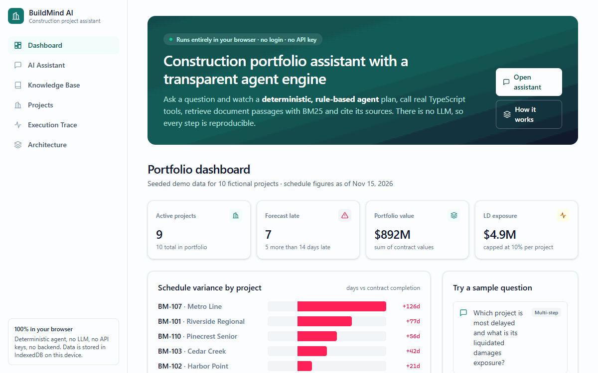
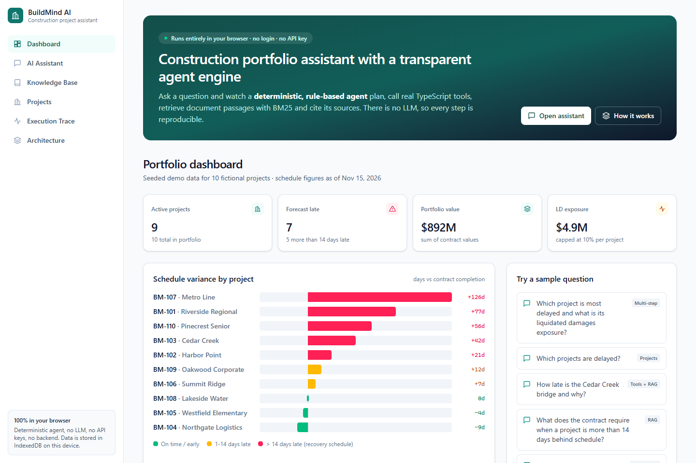
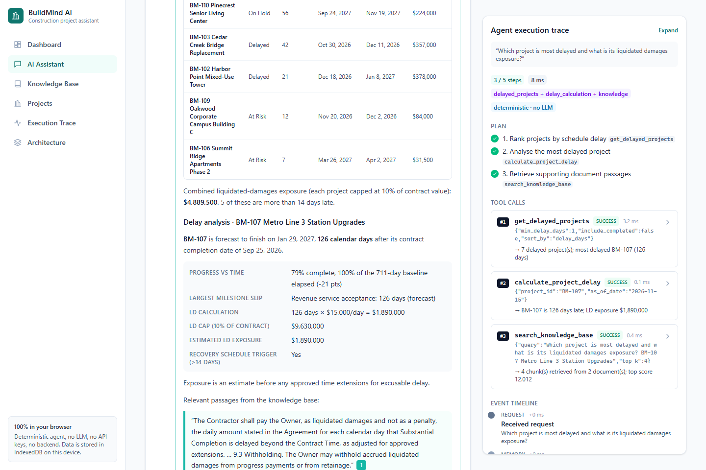
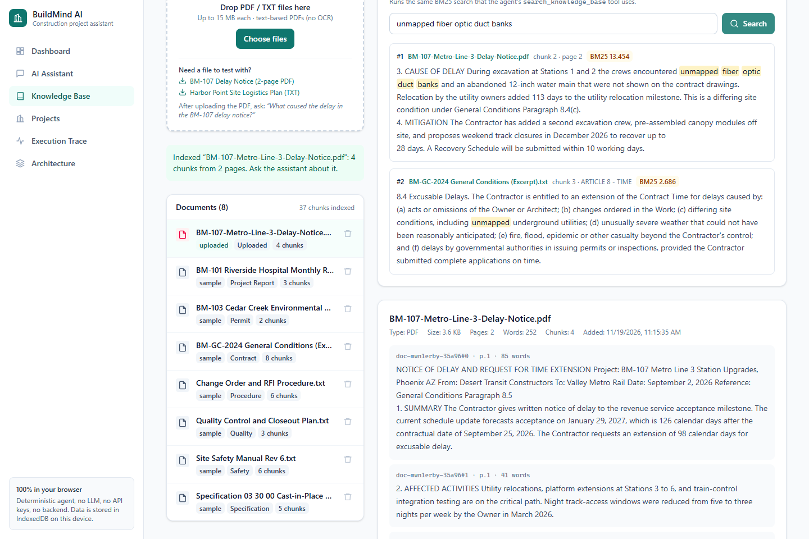
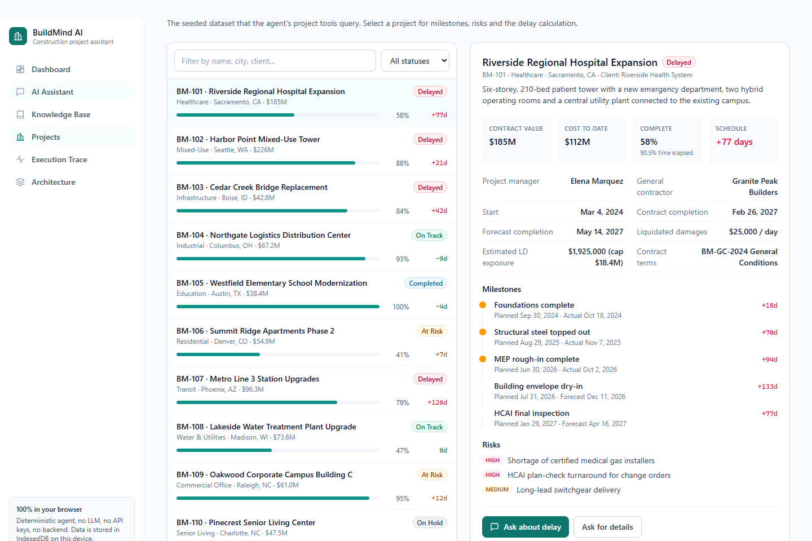
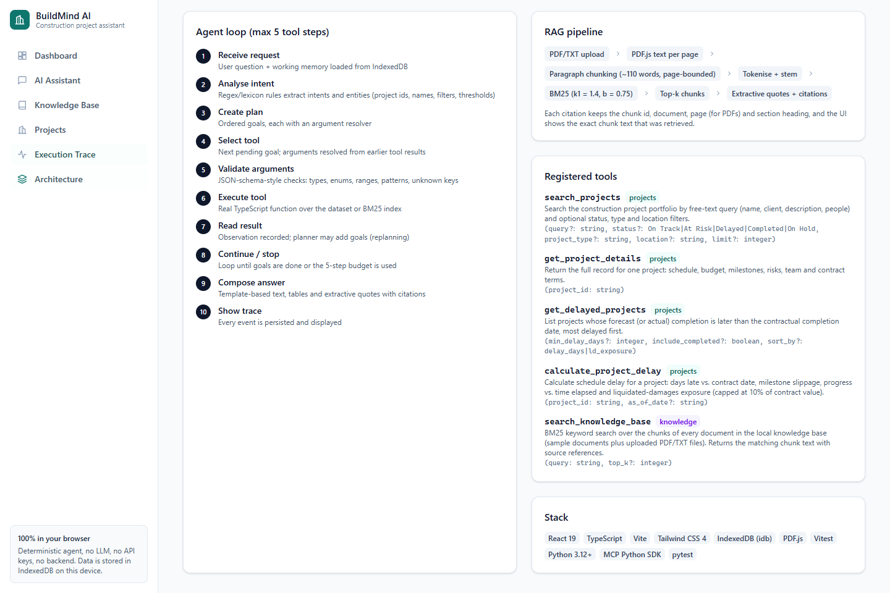

# BuildMind AI

**A construction-portfolio assistant that runs entirely in the browser.** It uses a deterministic agent engine, local retrieval over your documents (RAG), and a fully visible execution trace. The repository also contains a separate Python MCP server that exposes the same project data to MCP clients.

> **Honesty notes**
> - The public assistant is a **deterministic, rule-based agent written in TypeScript. It is not an LLM.** It never generates free-form text. Answers are assembled from real tool outputs and quoted document passages, and the same question always produces the same plan and answer.
> - The public website **does not connect to the MCP server.** The MCP server is a separate project that you run locally.
> - This is a portfolio demo, not a production-grade autonomous AI system. All projects, companies and documents are fictional.

**Live demo:** https://buildmind-ai-nine.vercel.app (no login, no API key)



| Dashboard | Multi-step agent run + citations | Knowledge base (PDF upload) |
|---|---|---|
|  |  |  |
| **Projects** | **Execution trace** | **Architecture** |
|  |  |  |

---

## What it does

- **No login, no API key, no backend, no paid services.** It is a static React app, and all data lives in your browser (IndexedDB).
- **A real agent loop**, capped at **5 tool steps**: it analyses intent, plans, selects a tool, validates the arguments, executes, reads the result, continues or replans, composes the answer, and shows the trace.
- **Five business tools** implemented as TypeScript functions over a seeded dataset of 10 construction projects:
  `search_projects`, `get_project_details`, `get_delayed_projects`, `calculate_project_delay`, `search_knowledge_base`.
- **Local RAG:** upload a PDF (text extracted with PDF.js) or a TXT file. It is chunked, indexed with BM25 and persisted in IndexedDB. Answers quote the retrieved chunk and cite its source: document, chunk id, page for PDFs, and section heading.
- **Memory:** the conversation and working memory survive a page reload, so follow-ups such as *"How many days late is it?"* resolve to the project from the previous turn.
- **Transparency:** every run records its intent signals, plan, each tool call (rationale, validated arguments, raw JSON result, timing), any replanning, and the final answer.

### Questions to try (they are also clickable in the app)

| Question | What happens |
|---|---|
| *Which project is most delayed and what is its liquidated damages exposure?* | `get_delayed_projects` → `calculate_project_delay` (its id comes from step 1's result) → `search_knowledge_base` (the query is enriched with the project found) |
| *How late is the Cedar Creek bridge and why?* | Project name resolved to BM-103 → `calculate_project_delay` → retrieval cites the permit document |
| *What is the status of the water treatment project?* | `search_projects` finds exactly one match → the planner **replans** and adds `get_project_details` |
| *What does the contract require when a project is more than 14 days behind schedule?* | Pure RAG: quotes General Conditions §8.3 |
| *Tell me about BM-101*, then *How many days late is it?* | The second question resolves "it" from persisted memory |
| *Show details for BM-999* | The tool returns an error, and the answer reports it instead of inventing data |

---

## Architecture

```
┌──────────────────────────── Browser (static site: Vercel / GitHub Pages) ────────────────────────────┐
│                                                                                                       │
│  React UI ─ Dashboard · AI Assistant · Knowledge Base · Projects · Execution Trace · Architecture      │
│     │                                                                                                 │
│     ▼                                                                                                 │
│  AgentEngine ──► AgentPlanner (intent rules, plan, arg resolvers, replanning)                         │
│     │            ExecutionContext (calls, observations, step budget = 5)                              │
│     │            ToolExecutor ──► validateArgs (JSON-schema subset) ──► ToolRegistry                  │
│     │            ResponseComposer (templates + extractive quotes + citations)                         │
│     │            ExecutionTrace ──► IndexedDB (traces)       AgentMemory ──► IndexedDB (messages, kv) │
│     ▼                                                                                                 │
│  Tools: search_projects · get_project_details · get_delayed_projects · calculate_project_delay        │
│         search_knowledge_base ──► KnowledgeBase ──► BM25Index ◄── chunker ◄── PDF.js / TXT            │
│                                        └──► IndexedDB (documents, chunks)                             │
└───────────────────────────────────────────────────────────────────────────────────────────────────────┘

┌──────── Local machine only (not connected to the website) ────────┐
│  mcp-server/  Python · official MCP SDK (MCPServer) · stdio        │
│  search_projects · get_project_details · get_delayed_projects      │
│  same projects.json seed data · pytest · MCP Inspector             │
└────────────────────────────────────────────────────────────────────┘
```

### Agent engine ([web/src/agent](web/src/agent))

| Component | File | Responsibility |
|---|---|---|
| `AgentPlanner` | [planner.ts](web/src/agent/planner.ts) | Rule-based intent analysis and entity extraction (ids, project names, type/location/status filters, thresholds, pronouns). Builds goals whose **arguments are resolved at run time from earlier tool results**. `observe()` adds goals when results call for it (single search match → details; empty retrieval → retry). |
| `ToolRegistry` | [registry.ts](web/src/agent/registry.ts) | Registers tool definitions (name, description, input schema, `execute`, `summarize`). |
| `ToolExecutor` | [executor.ts](web/src/agent/executor.ts) | Validates arguments ([validation.ts](web/src/agent/validation.ts)), runs the tool, captures errors, and times the call. |
| `ExecutionContext` | [context.ts](web/src/agent/context.ts) | Per-run state: plan, calls, step budget, focus project. |
| `AgentMemory` | [memory.ts](web/src/agent/memory.ts) | Conversation history and working memory, persisted to IndexedDB. |
| `ExecutionTrace` | [trace.ts](web/src/agent/trace.ts) | Ordered event log, persisted per run (last 50). |
| `AgentEngine` | [engine.ts](web/src/agent/engine.ts) | Runs the loop above. Hard limit of 5 tool calls; skipped goals are reported. |
| `ResponseComposer` | [composer.ts](web/src/agent/composer.ts) | Deterministic answer blocks (text, tables, key/value, quotes) plus citations. |

### RAG ([web/src/rag](web/src/rag))

PDF.js extracts text per page → paragraph-packed chunks of about 110 words (never crossing pages, keeping the nearest heading) → lowercase, stopword removal and light stemming → **Okapi BM25** (k1 = 1.4, b = 0.75; the document title and heading are indexed with the body) → the top-k chunks go to the agent, which quotes the best-matching sentences and cites the chunk. Documents and chunks are stored in IndexedDB, and the index is rebuilt on load.

Limitations: keyword retrieval only (no embeddings), and no OCR for scanned PDFs.

---

## Run locally

```bash
# Web app (Node 20+)
cd web
npm install
npm run dev          # http://localhost:5173
npm test             # Vitest: agent engine, tools, validation, chunker, BM25, IndexedDB, PDF.js parsing
npm run build        # type-check + production build into web/dist

# MCP server (Python 3.12+)
cd mcp-server
python -m venv .venv && . .venv/Scripts/activate   # macOS/Linux: source .venv/bin/activate
pip install -e ".[dev]"
pytest -q
python -m buildmind_mcp
```

See [mcp-server/README.md](mcp-server/README.md) for MCP Inspector and client configuration.

Optional browser checks (use an installed Chrome/Edge through `playwright-core`):

```bash
cd web && npm run build && npx vite preview --port 4173
npm run e2e        # smoke test + regenerates docs/screenshots
npm run demo-gif   # regenerates docs/demo.gif
```

---

## Deployment

The frontend is a plain static build: **no environment variables, no secrets, no backend URL.**

### Vercel (Hobby)

1. Push this repository to GitHub.
2. In Vercel, choose **Add New → Project → Import** your repo.
3. Set **Root Directory** to `web`. The framework preset (**Vite**), build command (`npm run build`) and output directory (`dist`) are read from [web/vercel.json](web/vercel.json).
4. Click **Deploy**. The current production deployment is https://buildmind-ai-nine.vercel.app.

CLI alternative: `cd web && npx vercel --prod`.

Routing uses URL hashes (`#/assistant`), so no rewrite rules are needed.

### GitHub Pages (alternative)

Enable **Settings → Pages → Source: GitHub Actions**, then run the **Deploy to GitHub Pages** workflow ([.github/workflows/pages.yml](.github/workflows/pages.yml)). It builds with `BASE_PATH=/<repo-name>/`.

CI ([.github/workflows/ci.yml](.github/workflows/ci.yml)) runs the web tests and build plus the Python tests on every push.

---

## Acceptance checklist

| Criterion | How it is verified |
|---|---|
| Works without login or API key | Static build; no env vars or network calls besides loading the site itself |
| Agent executes real tools | `engine.test.ts` asserts tool results computed from the dataset (for example, BM-107 = 126 days late) |
| Multi-step execution | Chained run where step 2's argument comes from step 1's result; replanning test; 5-step limit test |
| RAG retrieves real uploaded content | `rag.test.ts` uploads a file, reloads a fresh `KnowledgeBase` from IndexedDB, and retrieves it. The browser E2E uploads the sample PDF through PDF.js and checks the page-2 chunk |
| Citations point to real chunks | Test asserts each citation's text equals the stored chunk text |
| Memory persists in browser | Memory follow-up test; E2E reloads the page and finds the conversation |
| MCP server runs locally | `test_stdio_transport_end_to_end` launches `python -m buildmind_mcp` as a subprocess |
| MCP Inspector discovers and calls tools | `npx @modelcontextprotocol/inspector --cli … --method tools/list` / `tools/call` (commands in the MCP README) |
| All tests pass | `npm test` (web) and `pytest` (MCP) |
| Production build succeeds | `npm run build` |

---

## Repository layout

```
buildmind-ai/
├── web/                      # Static React + TypeScript + Vite + Tailwind app
│   ├── src/agent/            # Agent engine (planner, registry, executor, context, memory, trace, composer)
│   ├── src/rag/              # Chunker, BM25, PDF.js extraction, IndexedDB-backed knowledge base
│   ├── src/tools/            # Business tools + delay calculation
│   ├── src/data/             # projects.json (10 projects) + sample documents
│   ├── src/ui/               # Pages and components
│   ├── public/samples/       # Sample PDF/TXT to try uploading
│   └── scripts/              # sample-PDF generator, E2E/screenshot and GIF scripts
├── mcp-server/               # Independent Python MCP server (official SDK) + pytest
├── docs/                     # Screenshots and demo GIF
└── .github/workflows/        # CI + optional GitHub Pages deploy
```

## License

MIT
